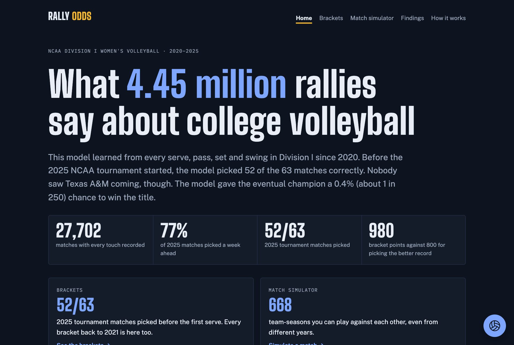
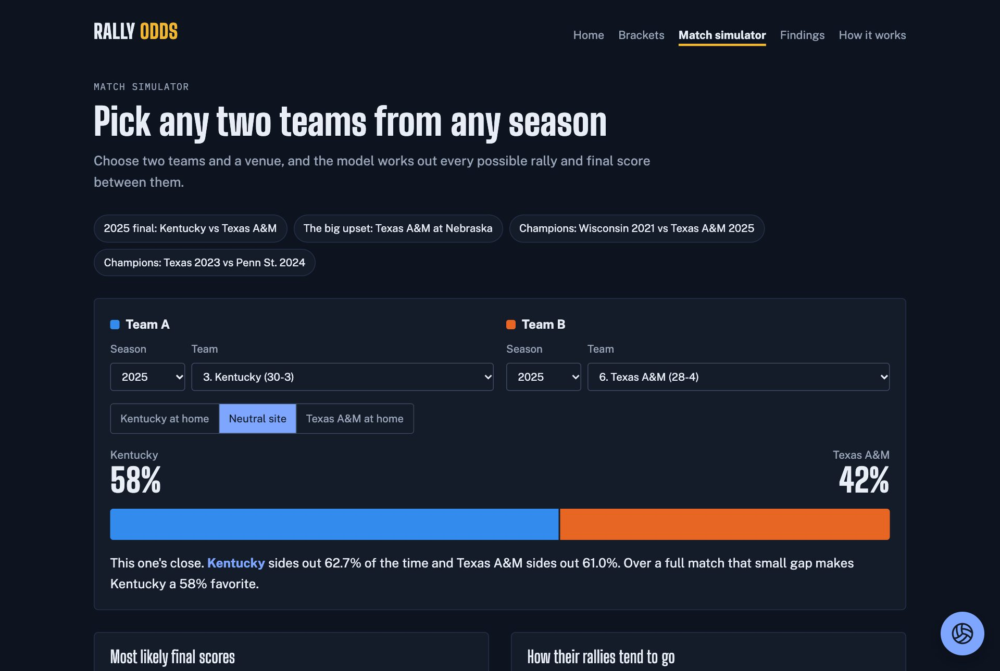

# Rally Odds

A rally-by-rally model of NCAA Division I women's volleyball, built from 4.45 million
rallies of play-by-play data. It predicts matches and NCAA tournament brackets, simulates
matchups between any two teams from 2020 to 2025, and tests what actually wins volleyball
matches.

**Live site: [m3tang.github.io/volleyball-sim](https://m3tang.github.io/volleyball-sim/)**



## What's on the site

- **Brackets:** every NCAA tournament from 2021 to 2025, predicted using only matches played
  before the first round, with each team's odds of reaching every round.
- **Match simulator:** pick any two teams from any season and venue. Win probability, likely final
  scores, and the part of the game that decides it.
- **Findings:** what separates elite teams, how much home court is worth, whether momentum
  is real, and how often the best team wins the title.
- **Under the hood:** the data, the twelve numbers the model learns per team, a step-by-step
  calculation of one rally, and how the model was tested.



## Results

Every prediction uses only matches played before it. Model settings were tuned on the
2024 season; 2025 is a held-out test.

**2025 season, predicted a week ahead (4,786 matches)**

| | accuracy | log loss |
|---|---|---|
| coin flip | 50.0% | 0.693 |
| rally model | 77.4% | 0.467 |

Predictions are calibrated: when the model gives a team 70%, it wins about 70% of the time.

**Against XGBoost.** As a machine learning baseline, an XGBoost classifier got 67 season-to-date
features for both teams (hitting, serving, blocking, record, previous season, home court), tuned
on 2024 and refit weekly under the same rules.

| test | matches | rally model log loss | XGBoost log loss | rally model accuracy | XGBoost accuracy |
|---|---|---|---|---|---|
| 2025, week by week | 4,786 | **0.467** | 0.497 | **77.4%** | 75.7% |
| NCAA tournaments 2021–2025 | 315 | **0.360** | 0.460 | **82.9%** | 76.2% |

The 2025 gap is 0.030 (95% bootstrap interval 0.020–0.040), and the rally model wins the
tournament in all five seasons. Most of the edge comes early in the season and in December,
where the rally model's prior from last season and its opponent adjustment matter most.
Reproduce with `python -m analysis.xgb_baseline` (writes `analysis/results/xgb_comparison.json`,
which the site build reads).

**NCAA tournament brackets, predicted before the first round** (standard scoring, max 1920)

| year | rally model | pick the better record | matches called (model) | champion |
|---|---|---|---|---|
| 2021 | 990 | 680 | 84% | Wisconsin |
| 2022 | 1310 | 650 | 83% | Texas |
| 2023 | 1190 | 720 | 84% | Texas |
| 2024 | 1070 | 880 | 81% | Penn St. |
| 2025 | 980 | 800 | 83% | Texas A&M |

## Findings: fan debates, tested

- **Do timeouts stop runs? No.** After the serving team scores two or more in a row, a timeout
  by the receiving team changes its chance of winning the next rally by −0.6 percentage points
  (95% range −1.9 to +0.5), from 7,956 timeouts in matches whose scorers logged them.
- **Is momentum real? Mostly no.** Scoring runs are reproduced by replaying every set with
  independent rallies plus a small match-day form swing. Teams down 0-2 come back 5.8% of the
  time (5.7% expected); set-1 winners win 78.8% (78.5% expected); favorites win 62.5% of fifth
  sets (59.8% expected), down from 72% before the match.
- **Serve tough or serve it in? Neither decides it.** Top-25 teams serve like everyone else
  (about 6.5% aces, 10% errors), and 24 of the 2025 top 25 missed more serves than they aced.
  Aces and service errors explain 2.5% of elite teams' edge; the first attack, stopping the
  opponent's first attack and the scramble after a dig explain the rest.
- **Bet on the favorite or the field? The field.** Pre-tournament favorites (24% to 64% title
  odds) won 1 of the 5 titles from 2021 to 2025, about half what their odds predicted. The last
  three champions each started below 2%.
- **Where does home court help? On attack.** Home teams win about 1 extra rally per 100, which
  turns an even match into 59/41. 85% of that edge comes from hitting (the first attack and the
  scramble), not serving.

## How it works

1. **Data.** Official play-by-play from stats.ncaa.org for every Division I match, 2020-2025:
   27,702 matches and 4.45 million rallies. Each row is one touch (serve, pass, set, attack,
   dig, block) with the player, team and score. Rallies are rebuilt from score changes, and
   the rebuilt match results agree with the official box scores for 99.94% of matches.
2. **Model.** Each rally is a chain of possessions: the serve (ace, error or in play), the
   receiving team's first attack (scores, loses the point, or the ball goes back), then the
   scramble. Each team-season gets twelve opponent-adjusted strengths, two per step, fitted
   with a penalized multinomial regression and pulled toward the previous season when data
   is thin.
3. **Exact calculation, not simulation.** The chain is solved in closed form for the chance
   of winning a rally. Exact recursions over every score give set and match odds, and an exact
   pass over every path through the bracket gives tournament odds. Match odds average over a
   small random swing in match-day form, which keeps long-shot odds calibrated.
4. **Testing.** Weekly refits through the 2025 season, brackets fit only on pre-tournament
   matches, and a comparison against a simpler model that rates each team with a single
   serving and receiving strength. The two predict equally well; the step-by-step model is
   used because it can explain *why* a team is favored.

## Repository layout

```
pipeline/   download the data, build the DuckDB database, validate it
vbsim/      the model: data loading, fitting, rally chain, match math, brackets
analysis/   model comparison, overconfidence and momentum tests, bracket scoring
web/        the site: template, build script, generated index.html and data.json
rallytools/ the model as tools: match odds, team profiles, brackets, upset breakdowns, safe SQL; MCP server; grounding checker
evals/      golden questions with computed answers, grader, runner for the question-answering agent
tests/      unit tests for the match math, fitting, bracket odds and the tools
```

## Run it yourself

Requires Python 3.12 (`brew install python@3.12` on a Mac).

```sh
python3.12 -m venv .venv
.venv/bin/pip install -r requirements.txt
.venv/bin/python pipeline/download.py        # ~4.5 GB of CSVs into data/raw/
.venv/bin/python pipeline/build_db.py        # builds data/vb.duckdb (~1.5 min)
.venv/bin/python pipeline/validate.py        # data checks; exits 1 on failure
.venv/bin/python -m pytest -q tests

.venv/bin/python -m analysis.evaluate_models # model comparison: tune on 2024, test on 2025
.venv/bin/python -m analysis.overconfidence  # momentum test and match-day form
.venv/bin/python -m analysis.xgb_baseline    # XGBoost baseline comparison (~10 min)
.venv/bin/python -m web.build_site           # refit everything and rebuild the site (~2 min)
open web/index.html
```

`web/index.html` is a standalone page with its data built in. Pushing to `main` deploys
`web/` to GitHub Pages. After editing only `web/template.html`, rebuild with
`python -m web.build_site --page-only`.

## Ask the model from Claude (MCP server)

`rallytools/server.py` exposes the model as ten read-only tools over the
[Model Context Protocol](https://modelcontextprotocol.io), so Claude Code, Claude Desktop or any
MCP client can answer questions like "Could 2025 Nebraska have beaten 2023 Texas?" with the
model's own numbers.

| tool | what it returns |
|---|---|
| `win_probability` | exact match odds for any two team-seasons and venue, set and final-score odds, rally-step rates |
| `team_profile` | rank, record, rating and the twelve rally-step numbers, counted and opponent-adjusted |
| `season_rankings` | end-of-season rankings |
| `bracket_forecast`, `advancement_odds` | pre-tournament title and round-by-round odds, bracket score |
| `tournament_matches` | tournament results with the model's pre-match odds; upsets only if asked |
| `explain_upset` | points each part of the game swung toward the winner, actual vs expected |
| `sql_schema`, `query_stats` | one read-only SELECT over the database (table allowlist, 200-row cap, 10 s timeout) |
| `model_facts` | coverage, known gaps, tested accuracy |

The model tools read `web/data.json`, the same parameters the site runs on, so they return the
numbers the site shows (tests check them against the site's JavaScript math). Nothing is refit,
so every call is instant and deterministic. The SQL tool needs `data/vb.duckdb`.

**Claude Code:** the repo's `.mcp.json` registers the server; open the repo and approve it.
**Claude Desktop:** add this to `claude_desktop_config.json`, with your own path:

```json
{"mcpServers": {"rally-odds": {
  "command": "/path/to/volleyball-sim/.venv/bin/python",
  "args": ["-m", "rallytools.server"],
  "env": {"PYTHONPATH": "/path/to/volleyball-sim"}}}}
```

Check it without a client: `.venv/bin/python -m rallytools.server --check`.

## Evals: is the agent right, and are its numbers real?

`evals/` measures a question-answering agent built on these tools. Every expected answer is
computed, never written by a model: 150 questions across match odds, cross-season matchups,
team profiles, rankings, brackets, upset explanations, SQL stats, and 15 questions the data
can't answer (injuries, 2026, betting), where the right answer is to decline. Review them in
[`evals/golden.md`](evals/golden.md).

| metric | what it checks |
|---|---|
| correct | every expected number and fact is in the answer, at the precision written ("87%" passes for 0.873, "88%" fails) |
| hallucination rate | share of numbers in answers that no tool call returned ([`rallytools/grounding.py`](rallytools/grounding.py)) |
| tool choice | some call could produce the answer, with the right teams, seasons and venue (any valid route counts) |
| refused | declined to answer; right on out-of-scope questions, wrong everywhere else |

The grader is tested before it grades anything real. `python -m evals.run --selftest` pushes
five fake answerers through the full pipeline and fails unless each lands where it must:

| answerer | correct | hallucination rate | tool choice |
|---|---|---|---|
| oracle (calls the right tool, states the answer) | 100% | 0% | 100% |
| same text, no tool calls | 100% | 100% | 0% |
| oracle with every number nudged | 12% (fact-only cases) | 84% | 100% |
| declines everything | 10% (the out-of-scope cases) | 0% | 0% |
| empty answer | 0% | – | 0% |

The perturbed row is also the grounding checker's measured limit: 16% of plausible wrong numbers
happen to match some other value in a large tool result (a team profile carries dozens of rates),
so grounding is a backstop and correctness checks the numbers that matter against their exact source.

```sh
.venv/bin/python -m evals.golden --check          # golden answers still match the model and data
.venv/bin/python -m evals.run --selftest          # harness and grader sanity check (free, runs in CI)
.venv/bin/python -m evals.run --answerer <module:function> --variant baseline   # a real agent
```

## Working with the data

The pipeline writes these tables to `data/vb.duckdb`:

| table | one row per | notes |
|---|---|---|
| `events` | play-by-play row | filled-in score, `rally_no`, `row_type`, `actor_team` |
| `rallies` | rally | score before, `serve_team`, `point_team`, `sideout`, `usable` |
| `sets` | set | final score, `legal_final` |
| `matches` | match | teams, sets won, `clean` flag, data-quality counts |
| `team_match`, `team_season`, `player_match`, `player_season` | | box scores as published |

Things about the source data worth knowing:

- `score` is away-home, and it is the score *after* that row's event. A rally ends on the row
  where the score changes. During TV timeouts the score field holds "Media timeout".
- On attack and service error rows, the `team` column names the team that **won** the point.
  The pipeline works out who made each touch from the player's team instead.
- Some matches, mostly 2020-2022, use an older format with "Point X: ..." summary rows.
- The 2025 file lists about 1,700 matches twice; the pipeline keeps one copy. Dates like
  `09/28/2024(2)` mark a team's second match that day.
- Touch quality, ball location, block touches that stay in play, and lineups are not recorded.

## Data and license

Data comes from the [ncaavolleyballr](https://jeffreyrstevens.github.io/ncaavolleyballr/)
project by Jeffrey R. Stevens (MIT license), which collects it from stats.ncaa.org. Raw data
is downloaded by `pipeline/download.py` and is not stored in this repository.

Code is released under the [MIT License](LICENSE).
